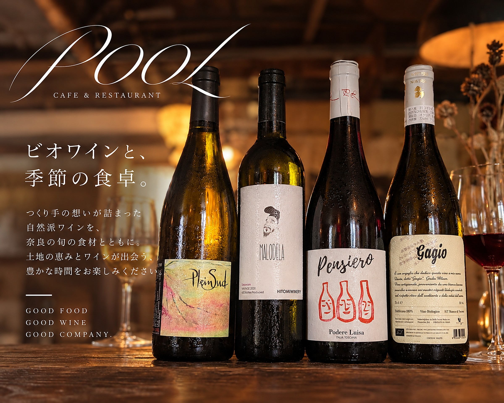
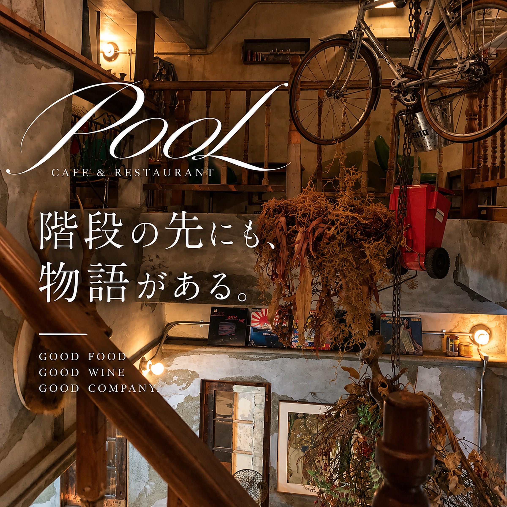

title: 奈良野菜のピクルスと、自然派ワインの夜
date: 2026-10-31
tag: MENU
photo: drive3.jpg
alt: 金縁の白いお皿に、色とりどりの野菜のピクルスをのせ、ディルを添えた一皿
---
奈良の船橋町にあるカジュアルフレンチ、CAFE & RESTAURANT POOLから、自家製ピクルスと自然派ワインのご紹介です。

白いお皿に、にんじんやきゅうり、赤いかぶ、パプリカなど、色とりどりの野菜が並びます。ディルを添えて、ひと口ずつ楽しめる彩りです。

## 野菜に合わせて、ワインを

POOLでは、料理に合わせて選べるよう、自然派ワインを種類豊富に揃えています。野菜の味わいを、ゆっくりワインと一緒にどうぞ。

## 階段の先にも、物語がある

もとは下駄屋だった一戸建てをリノベーションしたお店です。階段のまわりには、自転車やドライフラワー、レコードが飾られています。近鉄奈良駅から徒歩9分、ぜひお立ち寄りください。

ご予約は、お電話（0742-42-6430）またはInstagramのDMで。
