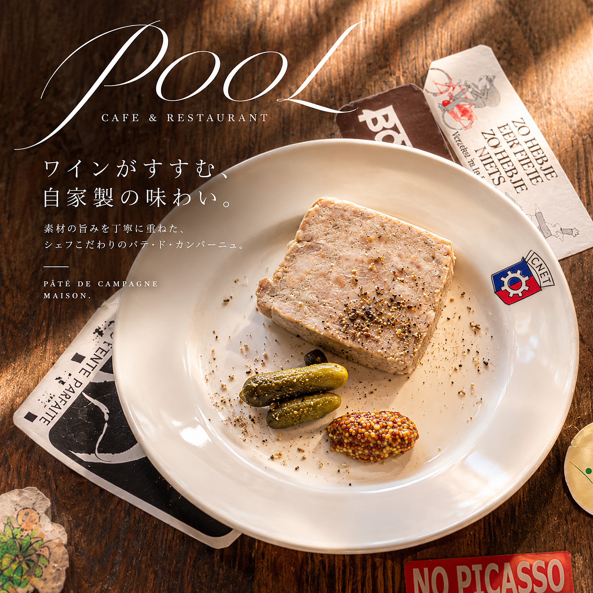

title: 奈良で味わう、前菜の盛り合わせとパテ
date: 2026-11-01
tag: MENU
photo: drive1.jpg
alt: サラミや生ハム、パテ、キャロットラペ、オリーブ、パンやクラッカーをのせた前菜の盛り合わせ
---
奈良の船橋町にあるカジュアルフレンチ、CAFE & RESTAURANT POOLから、前菜の盛り合わせと自家製パテのご紹介です。

白いお皿に、サラミと生ハム、鮮やかなキャロットラペ、オリーブ、きのこのマリネ、パテ、パンやクラッカーが並びます。少しずつ、いろいろな味わいをワインと一緒に楽しめる一皿です。前菜の盛り合わせは、POOLの看板の一皿です。

## パテ・ド・カンパーニュを、ゆっくりと

こちらは、パテ・ド・カンパーニュ。黒こしょうをふったパテに、小さなきゅうりのピクルスと粒マスタードを添えています。料理に合わせて選べるよう、自然派ワインも種類豊富に揃えています。近鉄奈良駅から徒歩9分です。

ご予約は、お電話（0742-42-6430）またはInstagramのDMで。
