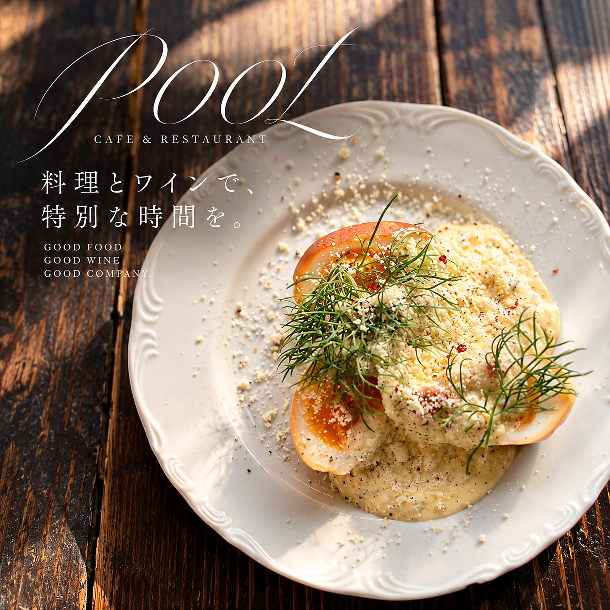
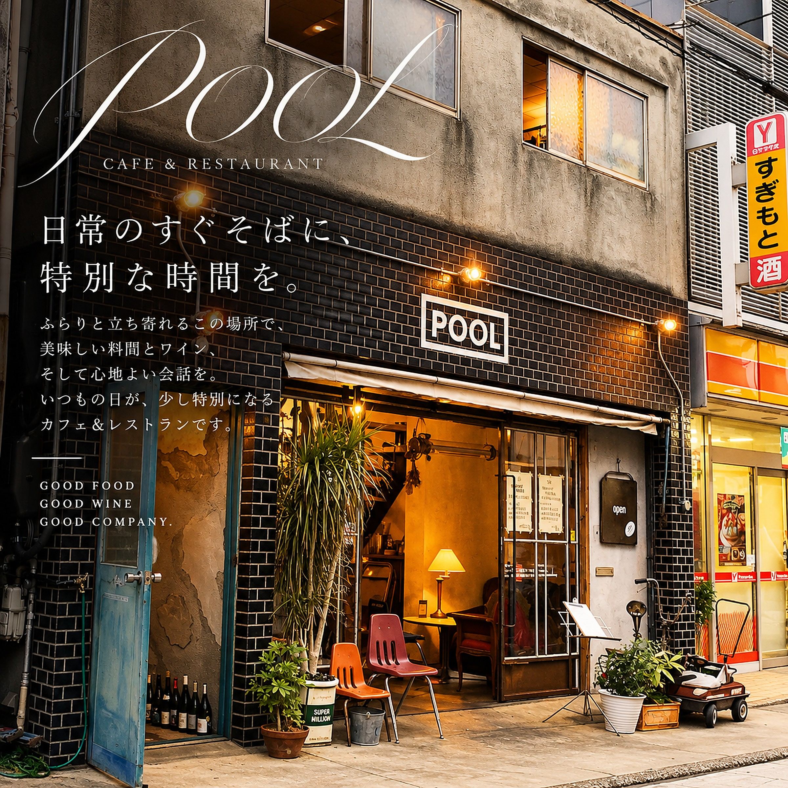

title: 奈良で味わう、季節の肉料理とやさしい卵の一皿
date: 2026-11-04
tag: MENU
photo: drive1.jpg
alt: 芽キャベツやグリルした野菜、ソースを添えた、白いお皿の肉料理
---
奈良の船橋町にあるカジュアルフレンチ、CAFE & RESTAURANT POOLから、肉料理と卵料理のご紹介です。

白いお皿には、こんがり焼き色のついたお肉に、焼いた芽キャベツやねぎ、緑のなめらかなソース、粒マスタード、赤いソースが彩りよく並びます。旬の野菜や果物を使い、食材にこだわるのが、POOLの料理です。

## ふわっとやさしい、卵の一皿

こちらは、半熟の卵にクリーミーなソースを合わせ、チーズとこしょう、ディルをあしらった一皿です。縁に飾りのある、素朴なお皿でお出しします。料理に合うワインも、種類豊富に揃えています。

## 船橋町の、黒いタイルの外観

お店は、黒いタイルの壁と「POOL」の看板が目印です。近鉄奈良駅から徒歩9分、ランチにもディナーにもお使いいただけます。

ご予約は、お電話（0742-42-6430）またはInstagramのDMで。
