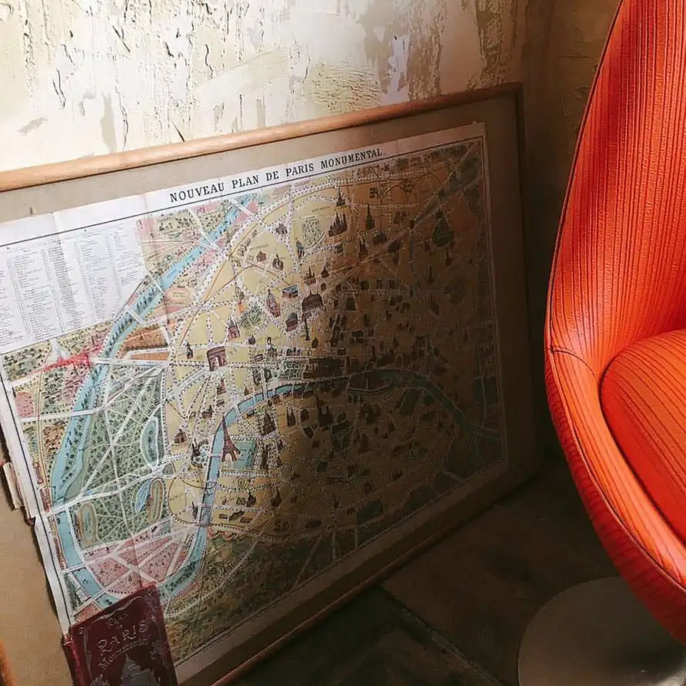

title: 船橋町で、ヴィンテージの店内をのんびり
date: 2026-11-13
tag: SPACE
photo: drive1.jpg
alt: 黄色いプラスチックの椅子と木の階段、観葉植物、白いホーロー製のやかんが見える、ヴィンテージ感のある店内の一角
---
奈良・船橋町のカジュアルフレンチ、CAFE & RESTAURANT POOLの、店内の一角をご紹介します。

写真には、大きな葉の観葉植物が伸びる木の階段と、鮮やかな黄色の椅子。奥の棚には食器やポットが並び、右側には白いホーローのやかんがのっています。古い壁の色合いと、使い込まれた道具のやわらかな雰囲気が、ゆっくりとした時間によく似合います。

## 壁には、古いパリの地図も

こちらは、額に入った古いパリの地図。かすれた壁に立てかけられ、右にはオレンジ色の椅子が見えます。小さな一角にも、お店のこだわりが詰まっています。

もとは下駄屋だった一戸建てをリノベーションした店内は、ヴィンテージ感と現代的な洗練が混ざる空間です。1階は通りに面した明るいソファー席、2階席は吹き抜けになっています。ランチにも、ディナーにも、忘年会・新年会のご相談にも。ぜひ [宴会・貸切のご案内](/party/) もご覧ください。

近鉄奈良駅から徒歩9分です。ご予約は、お電話（0742-42-6430）またはInstagramのDMで。
