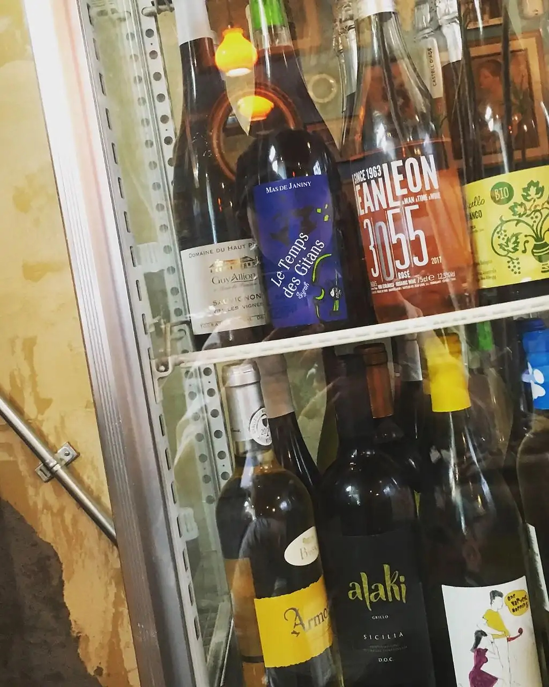

title: 奈良で、自然派ワインと吹き抜けの店内を
date: 2026-11-16
tag: SPACE
photo: drive1.jpg
alt: 吹き抜けの2階の手すりに、自転車が吊るされた店内。観葉植物と、古い壁、棚に並ぶレコードが見える
---
奈良・船橋町のカジュアルフレンチ、CAFE & RESTAURANT POOLの、吹き抜けの店内とワインをご紹介します。

写真には、2階の手すりに吊るされた自転車と、天井へ伸びる観葉植物。かすれた古い壁、棚に並ぶレコード、あたたかな明かりが、ヴィンテージ感のある空間をつくっています。2階席は吹き抜けになっていて、1階とゆるやかにつながっています。

## ワインも、種類豊富に

こちらは、ワインのボトルが並ぶ冷蔵庫。ラベルの絵柄もさまざまで、見ているだけでも楽しくなります。お店では、料理に合うワインを、自然派ワイン（ナチュール・ビオワイン）も含めて種類豊富に揃えています。

ランチにも、ディナーにも。忘年会・新年会のご相談もお受けしています。
→ [自然派ワインのページ](/natural-wine/)　[忘年会・新年会のご相談](/party/)

近鉄奈良駅から徒歩9分です。ご予約は、お電話（0742-42-6430）またはInstagramのDMで。
