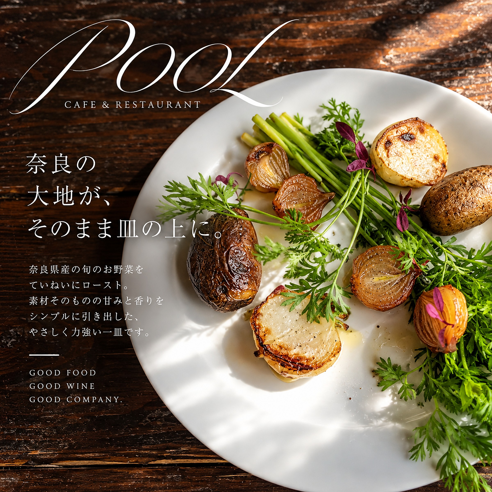

title: 奈良で味わう、季節の野菜の一皿
date: 2026-11-19
tag: MENU
photo: drive1.jpg
alt: 白いお皿に、赤紫のキャベツやピンクの大根、ブロッコリー、きゅうりなど色とりどりの野菜を盛りつけた一皿
---
奈良・船橋町のカジュアルフレンチ、CAFE & RESTAURANT POOLの、季節の野菜の料理をご紹介します。

白いお皿に、赤紫のキャベツ、鮮やかなピンクの大根、ブロッコリー、きゅうりなどが、ハーブとソースを添えて彩りよく並びます。コンセプトは「奈良で奈良野菜を楽しむカジュアルフレンチ」。旬の野菜を、シンプルに、ていねいに。

## こんがり焼いた野菜も

こちらは、焼き色をつけたじゃがいもや玉ねぎに、緑の葉を添えた一皿。野菜そのものの味を楽しめそうな、素朴であたたかな見た目です。

ランチにも、ディナーにも。近鉄奈良駅から徒歩9分です。ご予約は、お電話（0742-42-6430）またはInstagramのDMで。
