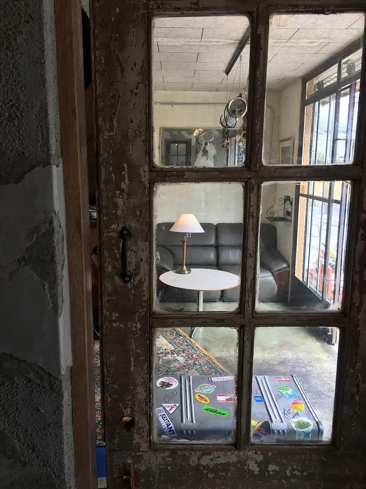

title: 奈良の吹き抜けと古い扉、船橋町の店内
date: 2026-11-22
tag: SPACE
photo: drive1.jpg
alt: 吹き抜けの高い位置から見下ろした店内。鎖でつり下げられた自転車と、味わいのある壁、額に入った絵、植物が見える
---
奈良・船橋町のカジュアルフレンチ、CAFE & RESTAURANT POOLの店内の様子をご紹介します。

上から見下ろした写真には、鎖でつり下げられた銀色の自転車と、風合いのある壁、額に入った絵、緑の植物が写っています。POOLはもとは下駄屋だった一戸建てをリノベーションしたお店で、2階席は吹き抜けです。

## 古い扉のむこうに

こちらは、年月を重ねた木の扉のガラス越しに見える店内。ランプと丸いテーブル、ソファが、やわらかな雰囲気です。

ランチにも、ディナーにも。忘年会・新年会のご相談もお気軽にどうぞ。近鉄奈良駅から徒歩9分です。ご予約は、お電話（0742-42-6430）またはInstagramのDMで。
