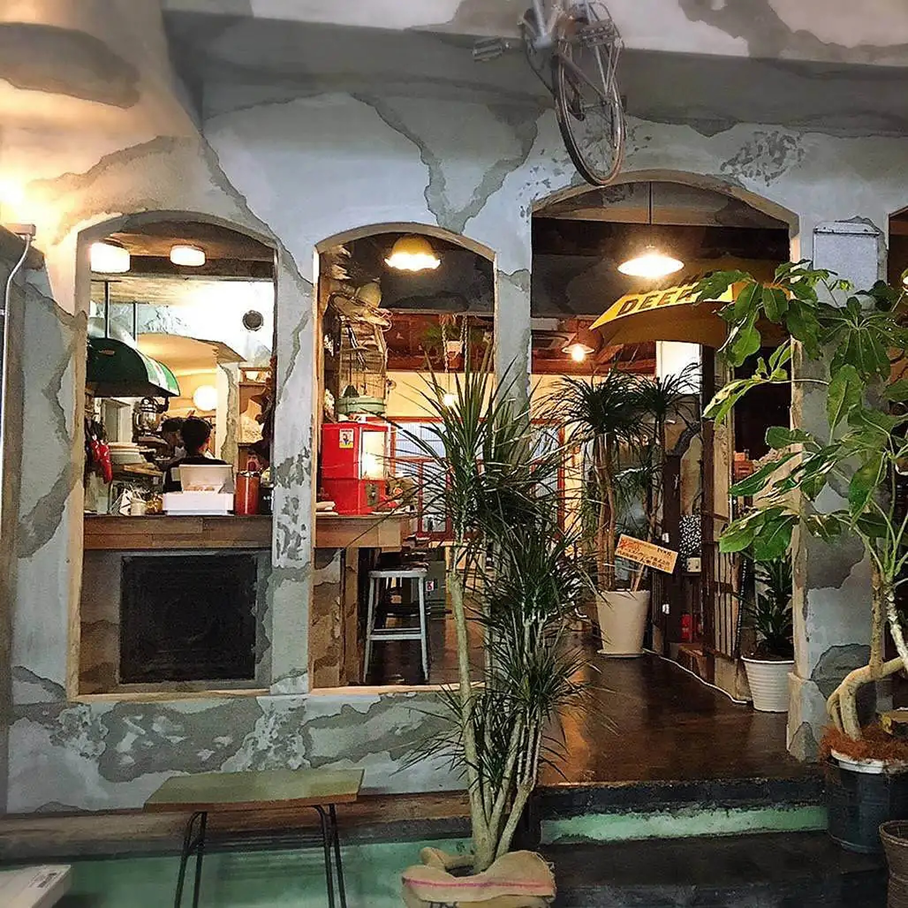

title: 奈良で味わう、野菜とお肉の前菜ディナー
date: 2026-11-25
tag: MENU
photo: drive1.jpg
alt: ラディッシュと食用花のサラダ、オレンジ色のソースの小皿、ピンク色に焼けたお肉と野菜の皿、グラスの飲み物がテーブルに並ぶ
---
奈良・船橋町のカジュアルフレンチ、CAFE & RESTAURANT POOLの、野菜とお肉のお皿をご紹介します。

古い木のテーブルに、いくつかのお皿が並んでいます。左には、うす切りのラディッシュに、赤い花を添えたサラダ。奥には、オレンジ色のソースを敷いた小さなお皿。手前の青い模様の器には、ピンク色に焼けたお肉と、にんじん、きのこ、ふわりとした泡が盛りつけられています。中央のグラスには、淡い色の飲み物が注がれています。

## お店の入口まわり

こちらは、壁のアーチ形の窓ごしに、店内の灯りと観葉植物が見える様子です。

旬の野菜を楽しむ夜のディナーにも、年末の集まりにも。忘年会・新年会のご相談もお気軽にどうぞ。近鉄奈良駅から徒歩9分です。ご予約は、お電話（0742-42-6430）またはInstagramのDMで。
