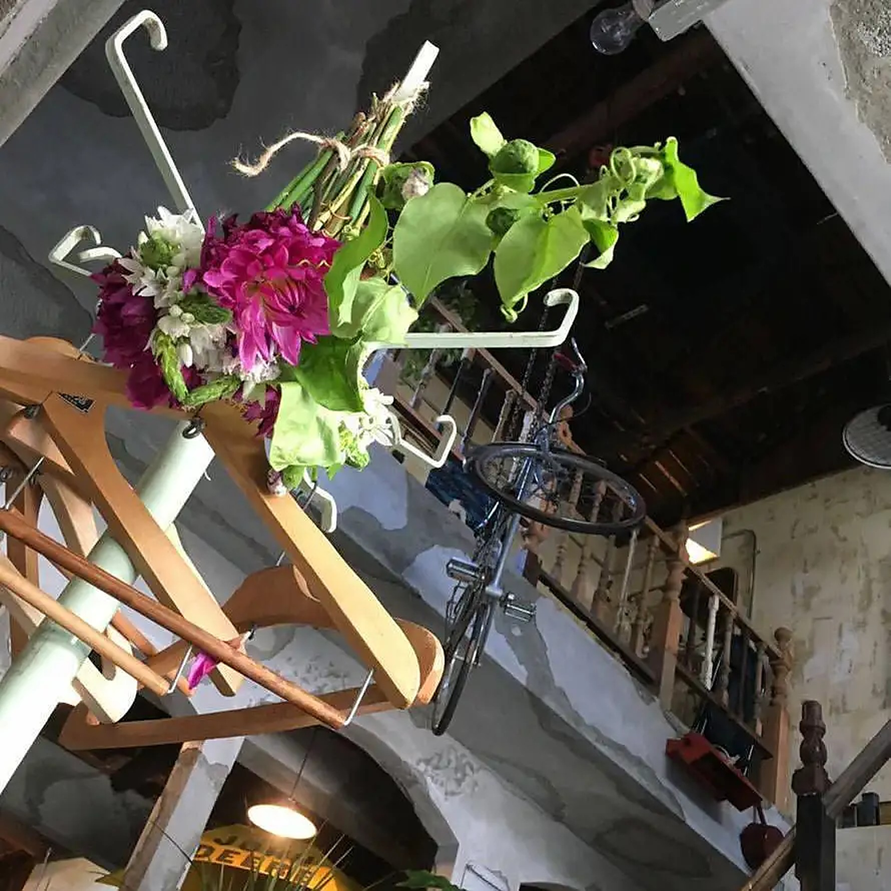

title: 奈良で楽しむ、色とりどりの旬野菜
date: 2026-11-28
tag: MENU
photo: drive1.jpg
alt: 白いお皿に並んだ、紫・白・緑・縞模様など、いろいろな種類のなす
---
奈良のカジュアルフレンチ、CAFE & RESTAURANT POOLから、野菜の写真をご紹介します。

白いお皿の上には、濃い紫のなす、真っ白な長いなす、小さな丸いなす、緑色のなす、紫と白の縞模様のなす。同じなすでも、色も形もさまざまです。

POOLのコンセプトは「奈良で奈良野菜を楽しむカジュアルフレンチ」。旬の野菜や果物を使い、食材にこだわっています。

## 店内にも、花と緑を

こちらは店内の一角。紫やピンクの花と緑の葉が、木のハンガーに飾られています。奥には、吹き抜けの高い場所につるされた自転車も見えます。

ランチにも、ディナーにも。近鉄奈良駅から徒歩9分です。ご予約は、お電話（0742-42-6430）またはInstagramのDMで。
